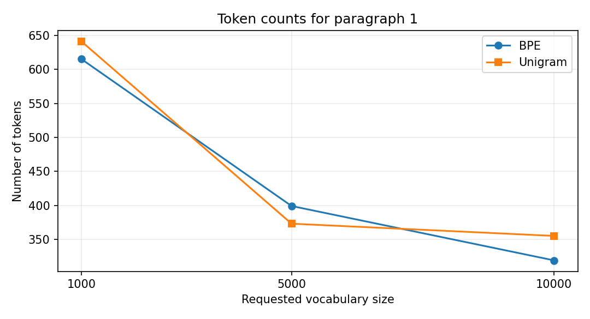

# Сравнение методов обработки русского текста

Учебный исследовательский проект по автоматической обработке русского текста на Python. На основе романа А.С. Пушкина **«Дубровский»** сравниваются методы сегментации текста на токены (**BPE**, **Unigram**) и морфологические анализаторы (**PyMorphy2**, **Stanza**).

Проект объединяет два эксперимента: исследование влияния размера словаря на разбиение текста и сопоставление результатов лемматизации. Код и результаты подготовлены в рамках учебных заданий по автоматической обработке текстов в МГТУ им. Н.Э. Баумана (2026).

## Используемые инструменты

- **Python** — обработка результатов, подсчет статистик;
- **SentencePiece** — обучение и применение токенизаторов BPE и Unigram;
- **PyMorphy2**, **Stanza** — морфологический анализ и лемматизация русского текста.

## 1. Сравнение токенизации

### Методика

На тексте «Дубровского» обучены шесть моделей SentencePiece: **BPE** и **Unigram** с запрошенными размерами словаря **1000, 5000 и 10000** токенов. Параметры обучения: `split_digits=True`, `byte_fallback=False`, `hard_vocab_limit=False`. Для сравнения выбраны три абзаца длиной свыше 200 символов; также применено простое разбиение на слова с удалением ряда знаков препинания.

Для конфигурации **Unigram 10000** фактический словарь составил **6217 токенов**. Для остальных пяти моделей фактический размер соответствовал заданному. Поэтому результаты при «10000» для BPE и Unigram **не являются сравнением при одинаковых фактических размерах словарей**.

### Результаты

Количество токенов на трех выбранных абзацах:

| Способ токенизации | Абзац 1 | Абзац 2 | Абзац 3 |
|---|---:|---:|---:|
| Разбиение на слова | 244 | 273 | 75 |
| BPE, словарь 1000 | 615 | 708 | 189 |
| BPE, словарь 5000 | 399 | 460 | 124 |
| BPE, словарь 10000 | 319 | 383 | 102 |
| Unigram, словарь 1000 | 641 | 745 | 202 |
| Unigram, словарь 5000 | 373 | 427 | 116 |
| Unigram, заданный словарь 10000 (фактически 6217) | 355 | 418 | 113 |



**Вывод.** На всех трех фрагментах увеличение словаря снижает число токенов. При размере 5000 Unigram дает меньше токенов, чем BPE; в конфигурации с заданным размером 10000 — наоборот, но фактические размеры словарей здесь различаются. Пословное разбиение дает меньше элементов, поскольку не разделяет слова на подтокены и удаляет пунктуацию: напрямую считать его «лучшим токенизатором» по этому показателю нельзя.

## 2. Сравнение морфологических анализаторов

### Методика

Для исходного текста Stanza выполняет **токенизацию, определение частей речи и лемматизацию** (`tokenize,pos,lemma`). После исключения пунктуации полученные словоформы передаются в PyMorphy2, для которого выбирается первый вариант разбора. Затем сравниваются списки лемм, их частоты и время обработки.

### Результаты

| Показатель | Результат |
|---|---:|
| Обработано словоформ | 20 717 |
| Несовпадения лемм | 2 211 |
| Доля несовпадений | 10,67% |
| Время выполнения PyMorphy2 | 3,154 с |
| Время выполнения Stanza | 31,897 с |

Примеры расхождений из эксперимента:

| Словоформа | PyMorphy2 | Stanza |
|---|---|---|
| поместий | поместье | поместия |
| Троекуров | троекур | троекуров |
| род | родиться | род |
| высшего | высокий | высший |

**Вывод.** Анализаторы дают разные результаты для части словоформ, особенно при обработке имен собственных. **10,67% — доля несовпадений**. Время выполнения является наглядной характеристикой разлчичия используемых инструментов, однако нужно учитывать, что Stanza выполняет несколько этапов обработки, а PyMorphy2 получает уже выделенные слова.

## Структура репозитория

```text
russian-text-processing/
├── README.md
├── requirements.txt
├── .gitignore
├── data/
│   └── Dubrovsky.txt
├── models/
│   ├── bpe_*.model, bpe_*.vocab
│   └── unigram_*.model, unigram_*.vocab
├── results/
│   └── token_counts.png
└── src/
    ├── train_tokenizers.py
    ├── tokenization_comparison.py
    └── morphology_comparison.py
```

`models/` содержит шесть сохраненных моделей и их словари; повторное обучение необязательно для изучения результатов токенизации.

## Как запустить

Необходимы Python и установленные зависимости:

```bash
python -m pip install -r requirements.txt
```

**Сравнить сохраненные токенизаторы:**

```bash
python src/tokenization_comparison.py
```

**Обучить модели заново (необязательно):**

```bash
python src/train_tokenizers.py
```

Повторное обучение перезаписывает файлы в `models/`.

**Сравнить морфологические анализаторы:** сначала загрузить русские ресурсы Stanza однократно:

```bash
python -c "import stanza; stanza.download('ru')"
python src/morphology_comparison.py
```

Скрипт морфологического сравнения использует `download_method=None` и ожидает, что ресурсы Stanza уже доступны локально.
